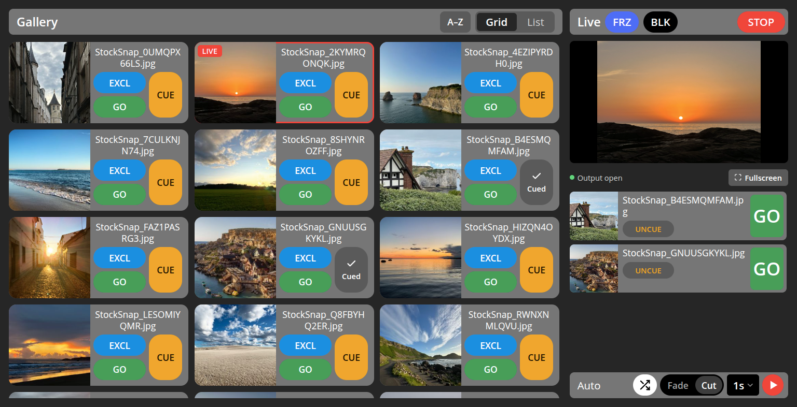

# SlideCue

**A single-file image presenter for live events: an Auto slideshow, an on-demand cue, and instant black / freeze.**
Point it at a folder, put the output window on the projector, and run the show from the control window.

[](https://revolut.me/leonampa) 
[](LICENSE)



### [Try out the Demo](https://leonampa.github.io/slidecut/demo)
---

**The problem.** Running photos at a live event (school show, service, wedding, talk) with a normal slideshow is all-or-nothing. You can't interrupt it for one specific image and then pick up where you were, and there's no safe way to go black or hold the frame without the audience seeing you fumble.

**The solution.** Two windows. The **control window** is yours; the **output window** is a clean, fullscreen canvas for the projector. Auto mode runs the loop, and the cue lets you put any image on screen in one press.

| Control | Behavior |
|---|---|
| **Auto** | Slideshow over the included images, in gallery order or **Shuffle**. Transition: Fade or Cut. Interval from 0.5 s. |
| **EXCL / INCL** | Per-image toggle. Excluded images are skipped by Auto but can still be shown manually. |
| **GO** | Show that image now. Pauses Auto. |
| **CUE / UNCUE** | Add an image to (or remove it from) the cue. |
| **ON** | Appears on the cue item that is on screen. Resumes Auto and removes the item from the cue. |
| **Play / Pause** | Resumes or pauses Auto. Does not touch the cue. |
| **FRZ** | Holds the current image and the Auto timer. |
| **BLK** | Black output, instantly. Auto is held until you release it. |
| **STOP** | Closes the output window and resets the app (asks for a second click). |

Drag and drop reorders the gallery and the cue, and you can drag gallery images into the cue. **A–Z** restores natural alphabetical order. Order, exclusions, cue and settings are remembered per folder.

| Key | Action |
|---|---|
| `Space` | Play/pause Auto (or **ON** when a cue item is held) |
| `B` / `F` | Toggle BLK / FRZ |
| `N` | Next image (pauses Auto, like GO) |

---

## Setup

**Requirements:** Chrome or Edge. Images: JPG, PNG, WEBP (subfolders included).

### Quick start

1. Download `index.html` and open it.
2. Click **Open folder** and choose your photos.
3. Click **Open output window**, then **Fullscreen ▸** and choose the projector screen. If Chrome refuses, double-click inside the output window.

### Auto-load a `pictures/` folder

Put a `pictures/` folder next to `index.html` and serve the directory:

```bash
python -m http.server   # open http://localhost:8000
```

On load the app looks for `pictures/` (directory listing first, then `pictures/index.json`). If it finds images it skips the folder prompt; otherwise it shows the normal **Open folder** screen. A page opened via `file://` can't read its own directory, so this needs http.

### GitHub Pages

1. Put photos in `pictures/` and push to `main`.
2. In **Settings → Pages**, set **Source** to **GitHub Actions**.

`.github/workflows/pages.yml` stages the site, runs `generate-manifest.js` to write `pictures/index.json`, and deploys. Add `?demo` (or `?demo=60`) to the URL to try it with generated test images.

### Netlify

Import the repo from GitHub. `netlify.toml` runs `node generate-manifest.js` on every deploy. Static hosts don't expose folder listings, so this generated manifest is how `pictures/` gets detected. Manual drag-and-drop deploys skip the build, so run the script yourself first.

> Anything in `pictures/` on a hosted site is public. Keep private photos local.

---

## How it works

- **Folder access:** File System Access API (`showDirectoryPicker`), with a `webkitdirectory` fallback. Files are read locally and never uploaded.
- **Output window:** a `window.open` popup that the control window drives directly. Images crossfade between two stacked layers and are decoded before each transition, so there's no blank frame. Screen selection uses the Window Management API where available.
- **Timing:** the Auto timer runs in a Web Worker, so it isn't throttled when the control tab is in the background. Effective playback is `autoPlaying && !FRZ && !BLK`, so releasing FRZ or BLK restores Auto automatically.
- **Performance:** thumbnails are generated lazily with `createImageBitmap`, a few at a time, and the next image is preloaded.
- **State:** kept in `localStorage`, keyed by folder name.
- **Layout:** two columns on desktop. Below 900px wide (small tablets, snapped windows, phones) it stacks: live preview, cue and Auto controls on top, gallery below, so the controls stay in reach while you scroll the grid.

## Limitations

- Chrome and Edge only. The narrow layout makes the control window usable on a small screen, but the output window itself needs a desktop browser that can open a second window.
- Drag and drop uses the HTML5 API, so it may be unreliable on touch screens.
- HEIC and video aren't supported.

## Repository layout

```
index.html              the whole app
generate-manifest.js    writes pictures/index.json (used by Pages / Netlify builds)
netlify.toml            Netlify build config
.github/workflows/      GitHub Pages deploy
pictures/               your images (optional)
screenshot.jpg                  screenshot
```

## License

[MIT](LICENSE)
